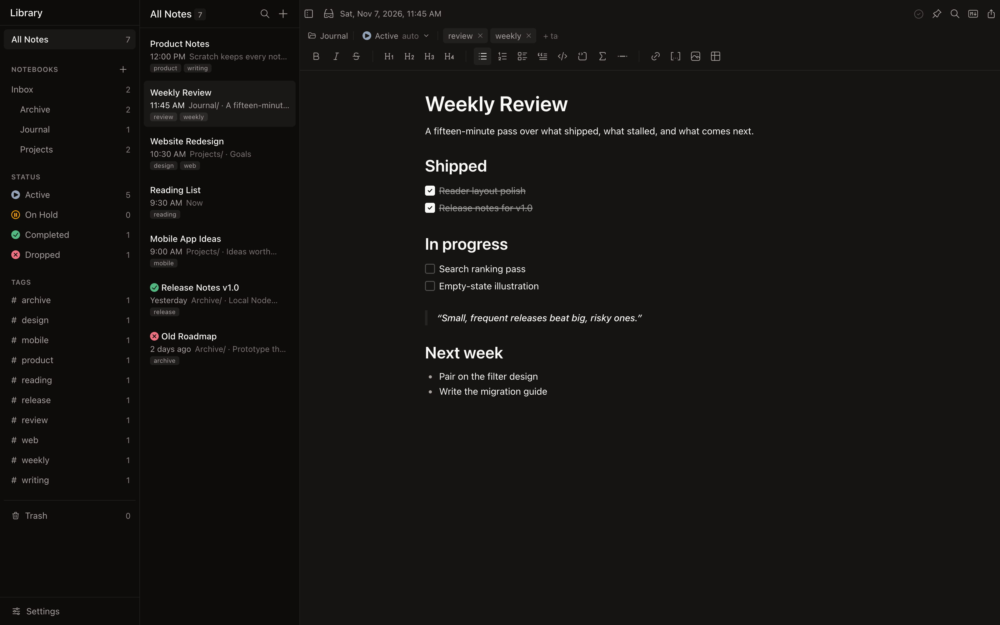

# Scratch


A minimalist, local-first markdown note-taking app. The UI is a PWA. A loopback Node server keeps the notes on this machine.

> **Fork:** This is a personal fork of [erictli/scratch](https://github.com/erictli/scratch). It replaces the original Tauri desktop shell with a loopback Node server and a PWA frontend. The Website and Releases links point to the upstream project.

  

[Website](https://www.ericli.io/scratch) · [Releases](https://github.com/erictli/scratch/releases)

## Features

- **Offline-first** - No cloud, no account, no internet required
- **Markdown-based** - Notes stored as plain `.md` files you own
- **WYSIWYG editing** - Rich text editing that saves as markdown
- **Preview mode** - Open a markdown file beside the notes folder, then import it
- **Markdown source mode** - Toggle to view and edit raw markdown (`Cmd+Shift+M`)
- **Syntax highlighting** - 20 languages with GitHub-inspired color scheme
- **Mermaid diagrams** - Render flowcharts, sequence diagrams, and more in fenced code blocks
- **KaTeX math** - Render block `$$...$$` math equations
- **Wikilinks** - Type `[[` to link between notes with autocomplete
- **Slash commands** - Type `/` to quickly insert headings, lists, code blocks, diagrams, and more
- **Zen mode** - Hides the library, note list, and all editor chrome so only the note remains (`Cmd+Shift+Enter`)
- **External edits** - Detects file changes made outside the app
- **Folders** - Opt-in collapsible folder tree with drag-and-drop to organize notes
- **Notebooks, status, and tags** - Library panel filters notes by notebook (Inbox plus nested folders), status, and tag
- **Trash** - Deletes move to Trash so they can be restored or permanently removed
- **Keyboard optimized** - Lots of shortcuts and a command palette
- **Customizable** - Theme, typography, page width, and RTL text direction
- **Git integration** - Optional version control with push/pull for multi-device sync

## Screenshot



## Library

The library panel groups notes by notebook (the note's folder, with vault-root notes in Inbox), status, and tag. Use the **+** next to Notebooks to create a top-level notebook; right-click a notebook to rename or delete it, and drag it onto another notebook (or the Notebooks header/Inbox) to re-nest it. Settings lives at the bottom of this panel. Status is derived from the note body unless it is set by hand:

| Note body          | Status    |
| ------------------ | --------- |
| Has open tasks     | Active    |
| All tasks done     | Completed |
| No tasks at all    | Active    |

Set a status from the meta bar above the editor. An explicit choice always wins, so a note with open tasks can be put On Hold or Dropped. Tags and status live in `.scratch/metadata.json` (not in the note body) and follow notes when they are renamed or moved. Deleted notes move to `.trash/` and stay restorable until purged.

## Run

**Prerequisite:** Node.js 18+

```bash
git clone https://github.com/erictli/scratch.git
cd scratch
npm install
npm run dev            # API on 127.0.0.1:4173, UI at http://localhost:1420
```

Production:

```bash
npm run build
npm start              # Serves dist/ and the API on 127.0.0.1:4173
```

Install the production page from the browser if you want a standalone window. The service worker does not cache requests.

## Keyboard Shortcuts

Scratch is designed to be usable without a mouse. Here are the essentials to get started:

| Shortcut          | Action                 |
| ----------------- | ---------------------- |
| `Cmd+N`           | New note               |
| `Cmd+D`           | Duplicate note         |
| `Delete`          | Delete note            |
| `Cmd+Backspace`   | Delete note            |
| `Cmd+P`           | Command palette        |
| `Cmd+K`           | Add/edit link          |
| `Cmd+F`           | Find in note           |
| `Cmd+Shift+C`     | Copy & Export menu     |
| `Cmd+Shift+M`     | Toggle Markdown source |
| `Cmd+Shift+Enter` | Toggle Zen mode        |
| `Cmd+Shift+F`     | Search notes           |
| `Cmd+R`           | Reload current note    |
| `Cmd+,`           | Open settings          |
| `Cmd+\`           | Toggle library panel   |
| `Cmd+B/I`         | Bold/Italic            |
| `Cmd+=/-/0`       | Zoom in/out/reset      |
| `↑/↓`             | Navigate notes         |

**Note:** On Windows, use `Ctrl` instead of `Cmd` for all shortcuts.

Many more shortcuts are in Settings → Shortcuts. The browser may keep `Cmd+W`, `Cmd+T`, `Cmd+N`, `Cmd+P`, and `Cmd+,`. The rest run from `keydown` while the page is focused.

## Built With

[React](https://react.dev/) · [TipTap](https://tiptap.dev/) · [Tailwind CSS](https://tailwindcss.com/) · Node.js

## License

MIT
